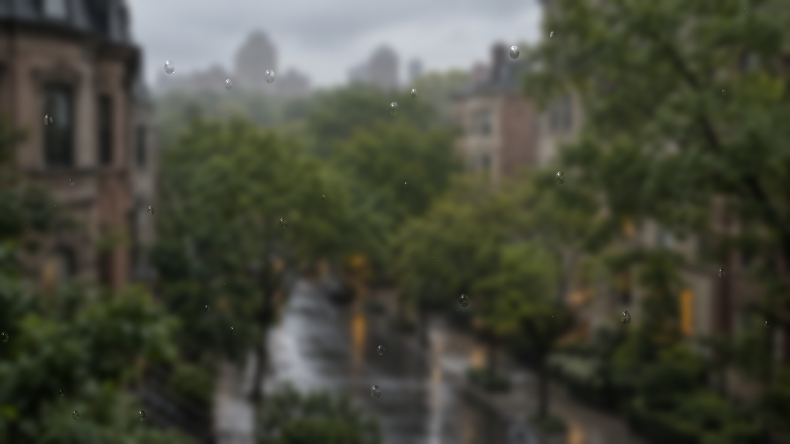
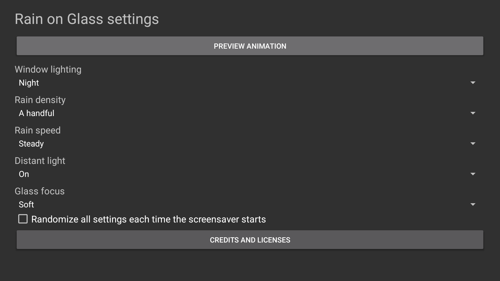
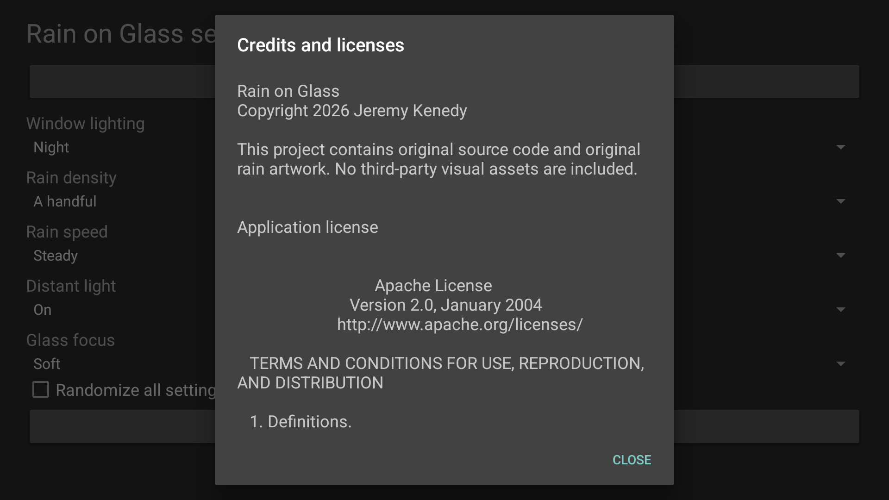
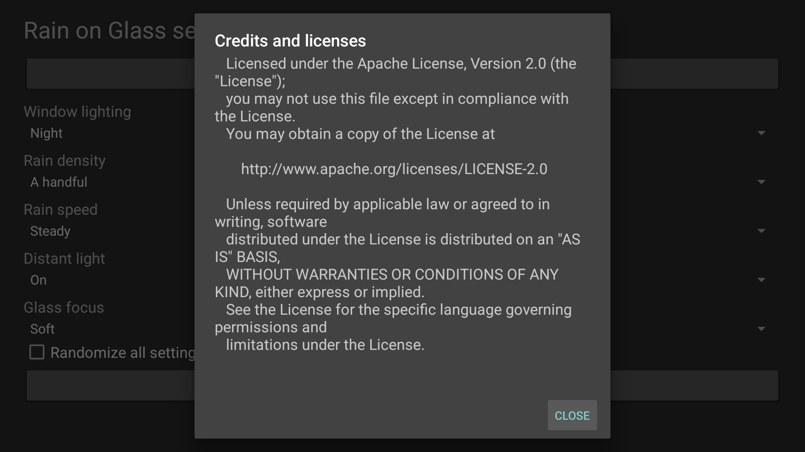

# Native screenshots

These images show the frozen 1.1.0/code 2 APK, SHA-256 `ca700f7717ed7d5e5aae1aa26da0615805a55cd8e0e8c066db81e69941aaf730`. The first row is a physical Fire TV AFTDEC012E/API 30; the credits and settings row is a Google TV API 34 emulator. All captures are 1920x1080.

<table>
  <tr>
    <td></td>
    <td></td>
    <td></td>
  </tr>
  <tr>
    <td></td>
    <td></td>
    <td>Credits, the complete license, Preview and Back were exercised with a D-pad. No network is required.</td>
  </tr>
</table>

[Physical provenance](../art/screenshots/physical-fire-tv.json), [API 34 provenance](../art/screenshots/credits-api34.json) and [verification](VERIFICATION.md) distinguish native workflow proof from physical performance and untested platforms.
